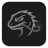

<div align="center">

# 🦎 Adgecko


**A Chrome extension (Manifest V3) that blocks ads on Twitch, YouTube, Kick and other websites, blocks known malware sites, and stops pages from copying shell commands into your clipboard.**

</div>

## What it does

- Blocks video ads on Twitch, YouTube and Kick (see the limits below).
- Blocks ads on other websites with public filter lists, and hides the empty boxes the ads leave behind.
- Blocks sites that public malware lists name as known-bad, on every page, without blocking the servers of Twitch, YouTube and Kick themselves. [Details](docs/threat-tier.md)
- Stops pages from putting a shell command into your clipboard (the "paste this into Run to verify you" trick).
- Optional pop-up guard: blocks pop-ups opened without a click (off by default).

It runs inside Chrome 137 or newer. There is no separate program and no account.

**Limits**

- Phishing pages are blocked only when a public list names them. Chrome's Safe Browsing stays your main phishing protection.
- Ads that are part of the video itself still play (for example, a sponsor read).
- On Twitch, the picture can drop to lower quality for a moment during an ad break, and an ad can still show when no ad-free copy of the stream is available.
- On Kick, some ads still play. Adgecko skips an ad only when it can do that safely.
- YouTube Music and YouTube Kids are not covered.

## Status

- Current version: **0.3.5** (`manifest.json`).
- Latest release: [v0.3.5](https://github.com/gecko-of-shadow/adgecko/releases/tag/v0.3.5), published 2026-11-15. All releases: [Releases](https://github.com/gecko-of-shadow/adgecko/releases). Changes: [CHANGELOG.md](CHANGELOG.md).
- Adgecko is not on the Chrome Web Store.

## Install

1. Get the files and unzip them. Pick one:
   - **Release zip:** [adgecko-0.3.5.zip](https://github.com/gecko-of-shadow/adgecko/releases/download/v0.3.5/adgecko-0.3.5.zip).
   - **Newest code:** the green **Code** button on this page, then **Download ZIP**. This can be newer than the last release; Chrome shows the version from `manifest.json`.
2. In Chrome, open `chrome://extensions`. If an older copy is loaded, remove it first.
3. Turn on **Developer mode** (top right).
4. Click **Load unpacked** and pick the unzipped folder (the one with `manifest.json` directly inside it). Keep the folder where it is: Chrome runs the extension from it.
5. Optional: click the puzzle-piece icon next to the address bar, then the pin next to **Adgecko**.

Removing the extension, or loading a copy from a different folder, forgets your allowed sites.

## Usage

It works as soon as it is installed. Click the gecko in the toolbar to open the popup.

- The popup shows the site and its state: **✅ Protected**, **Allowed – not blocking here**, or **Protected – some filters off here (Fix this site)**.
- **Something broke?** Click **Fix this site**. It turns off the hidden ad boxes and the page guards for this site only. Click **Reload page**, then answer **Did that fix it?** **Yes** keeps the fix (undo it with **Undo fix**). **No** turns the filters back on.
- **Still broken?** Click **Allow this site**. The ad lists stop blocking what this site loads, ad boxes are no longer hidden, and the pop-up guard is off on this site. The clipboard guard stays on, known malware sites stay blocked, and the built-in Twitch and YouTube ad blocking keeps running. **Block again** undoes it. An allow counts for the whole site address. [Details](docs/allow-a-page.md)
- **Chrome says "This page has been blocked by an extension"** for a site you trust? Click the gecko, then **Chrome says the page is blocked? Allow its domain**. Or open the settings page (the gear), type the domain in **Allow this domain**, and reload.
- **Show more** shows the list status and the version. The gear opens the settings page: every switch, the per-site list, the list update button and the popup look (Automatic, Purple or High contrast).

**Toolbar icon:**

 &nbsp; 

- Purple, with the pixel "ad" lit: blocking on ordinary sites is on.
- Grey: blocking on ordinary sites is off. If only the list blocking switch is off, the Twitch, YouTube and Kick filters keep running. The master switch also stops the Kick ad skip, the Twitch banner hiding, the YouTube helpers and the malware lists.
- A small magenta dot: a page guard blocked something on that tab. Open the popup to see what.

**Troubleshooting**

- **"Allow this site" is grey:** the popup says why. The extension may be off in settings; the page may be a Chrome page or was open before the extension loaded (reload it); or the site is YouTube Music, Studio, TV, Kids or youtube-nocookie ("Malware blocking only").
- **A copy button does not copy a command:** the clipboard guard stops pages from writing commands such as `powershell ...` or `curl ... | sh`. Select the text and press Ctrl+C yourself, or use **Fix this site**.
- **Blocked things still missing after you allow a site:** reload the page.

## Privacy and permissions

- No tracking, no account, no analytics. Settings stay in Chrome's storage in this browser.
- The extension checks its public filter lists every 3 hours, over HTTPS, without cookies. It contacts only the hosts in `host_permissions`: `easylist.to`, `pgl.yoyo.org`, `malware-filter.gitlab.io`, `ublockorigin.github.io`, `easylist-downloads.adblockplus.org` and `secure.fanboy.co.nz` (EasyList mirrors), `raw.githubusercontent.com` (HaGeZi and Dandelion Sprout lists only) and `filters.adtidy.org`. Those hosts see the list address and your IP address, not the page you visit.
- The clipboard guard checks text inside your browser only.
- On Twitch, it asks Twitch for ad-free copies of the stream.
- Permissions: `storage`, `declarativeNetRequest`, `alarms`, and host access to the list hosts above.

Full details: [docs/permissions-and-privacy.md](docs/permissions-and-privacy.md).

## Build from source

There is no build step. From a git clone, load the repository root (the folder with `manifest.json`) with **Load unpacked**. `docs/`, `test/` and `scripts/` are not part of the running extension.

Tests and checks need [Deno](https://deno.com/):

```bash
deno test --no-lock --allow-read --allow-run --allow-env test/
bash scripts/release-gate.sh
bash scripts/pack-zip.sh
```

- `scripts/pack-zip.sh` writes `adgecko-<version>.zip` with `manifest.json`, `src/` and `icons/` at its root.
- The version is the `version` field in `manifest.json`.
- Releases come from GitHub Actions (**Actions** → **release** → **Run workflow**, `main` only). The workflow packs the zip, runs the release gate, creates tag `v<version>`, and uses the matching `CHANGELOG.md` section as the release notes.
- To update the vendored Twitch script and the uBlock Origin YouTube filters, see [docs/UPDATING-DEPENDENCIES.md](docs/UPDATING-DEPENDENCIES.md).

## Project layout

```
manifest.json   extension manifest (Manifest V3)
src/            service worker, popup, settings page, content scripts
  rules/        packed filter rules (declarativeNetRequest) and list data
  guards/       clipboard and pop-up guards
  vendor/       vendored Twitch script and uBlock Origin YouTube filters
icons/          extension icons
scripts/        packing, release gate, list packer, dependency updates
test/           Deno tests
docs/           user and developer docs
```

More docs: [How it works](docs/how-it-works.md) · [Threat tier](docs/threat-tier.md) · [Signed threat feed setup](docs/feed-setup.md) · [Design](docs/design/README.md).

## License

- The code is licensed under the GNU General Public License version 3 ([LICENSE](LICENSE)). Copyright (C) 2026 gecko-of-shadow.
- Parts made by others keep their own licences: TwitchAdSolutions (MIT), uBlock Origin and uAssets (GPLv3), the EasyList lists and the other filter lists, including curbengh's urlhaus-filter (URLhaus data, CC0). See [docs/credits.md](docs/credits.md) and [src/rules/LICENSES.md](src/rules/LICENSES.md).
- The name "Adgecko" and the gecko icon are gecko-of-shadow's brand and are not covered by the code licence. If you share a changed copy, give it your own name and icon.
