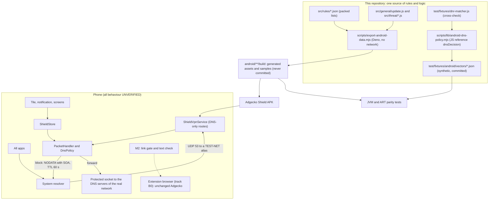

# Adgecko on Android: merged plan ("Adgecko Shield")

- Date: 2026-11-17.
- Base: this repository at commit 0e8dd60 (extension 0.3.6, GPL-3.0).
- Language: ASD-STE100.
- Status: plan. A research session made it on 2026-11-17 with 17 agents: 12 research agents (the evidence is in `docs/android/research-2026-11-17.md`), 3 designers, 2 judges, 1 merge agent and 1 fact checker.
- Next step: a cloud build session does milestone 1 (section 6). The ordered task list is in section 13.
- Records of the research session: `docs/android/session-2026-11-17.md` (course of the session, state at the archive, open items, lessons) and `docs/android/design-panel-2026-11-17.md` (the three designs, the judges, the fact check, the workflow scripts).
- Rule for all phone claims: each phone behaviour in this plan is UNVERIFIED until a run on the owner's phone proves it.

---

## 1. Goal and summary

### 1.1 Goal

The owner wants the 8 Adgecko jobs on an Android phone. The owner said: "think outside the extension". Thus this plan uses Android mechanisms where they do a job better than an extension, also for all apps. This repository stays the only source of rules, logic and decisions.

### 1.2 Summary

- The panel selected design "shield". Both judges selected it.
- The base is one small native app, "Adgecko Shield", in a new `android/` folder of this repository.
- The app uses three Android gates. No gate needs a dangerous permission. The app asks for `POST_NOTIFICATIONS` (a runtime permission) only for its status notification. The shield works without it.
  1. DNS gate: a local DNS-only `VpnService`. It blocks Adgecko's whole-domain ad, tracker and threat hosts in all apps. (M1)
  2. Link gate: the app holds the browser role and checks each tapped link before the real browser opens it. (M2)
  3. Text gate: "Check with Adgecko" in the selection menu, a share target and a clipboard tile. (M2)
- The web-only jobs (hide rules, stream scripts, page guards) stay in the unchanged extension. The extension runs in a browser that runs extensions (track B0, Vivaldi first). The Shield does not fork them.
- All rule data comes at build time from `src/rules/` and the JS modules in `src/`. Nothing derived is committed. Parity tests keep the Kotlin decisions equal to the JS decisions.
- Milestone 1 (M1) is the DNS shield with one-tap controls, a Self-test and an About screen. It is a working prototype that protects all apps. The owner can install it with adb and check it in about 15 minutes.

### 1.3 Panel decisions

| Item | Decision | Reason |
|---|---|---|
| Winner | Design "shield". | Both judges selected it (feasibility 38, value 49). It matches the owner's request: native gates for all apps, and the unchanged extension in a browser for the web-only jobs. It commits no derived data. It has the fewest M1 libraries. Its merged-manifest policy and its separate probe app give strong proof. |
| M1 scope | DNS shield only. The link gate and the text check move to M2. | The judges disagreed. Feasibility: move both out. Value: keep the text check, put the link gate last. I move both out. (1) The text check needs regex parity on ART. Only the CI emulator shows ART behaviour, so each fix costs one CI round trip. (2) The link gate holds the browser role. A defect there stops all links on the phone. (3) The DNS shield alone protects all apps and gives a visible result in 15 minutes. One build session can finish it. |
| List filter for DNS | Same meaning as the extension: remove IP literals and the hosts that `isNeverBlock()` rejects. Do not apply `protectedReason()` to list hosts. | Value-judge graft. The extension's list tier leaves shared platforms to the lists on purpose (comment above `localAddress()` in `src/general/update.js`, checked). `protectedReason()` would remove 268 real names, for example `ads.twitter.com` and `telemetry.dropbox.com` (checked). The owner can select a narrower filter (decision OD-10). |
| Never-block model | `{suffixes, except}`, the same data as `isNeverBlock()`. | It keeps `imasdk.googleapis.com` blockable. It removes the reversed-meaning blocker of design "shield". |
| Oracle | A JS reference `dnsDecision()` is the oracle for Kotlin. `test/fixtures/dnr-matcher.js` cross-checks the JS reference. | Graft from design "core". It tests the DNS projection and the DNR meaning separately. |
| Vectors | Committed synthetic vectors (reserved names only) with a closed-set runner, plus real-data samples in `build/` only. | Graft from design "core". Synthetic vectors pass the privacy check. Real samples contain list hosts, so they stay in `build/`. |
| AndroidX in M1 | No runtime AndroidX library in M1. | This removes the merged-manifest additions of `androidx.core` (an extra permission) and `profileinstaller` (an exported receiver). M1 uses platform classes only. |
| Own package and the VPN | M1 does not exclude its own package from the VPN. | The Self-test needs the normal DNS path. The app sends no other traffic in M1. The upstream socket uses `protect()`. |

### 1.4 Hard blockers and how this plan removes them

| Blocker (source) | Fix in this plan |
|---|---|
| ART rejects `UNICODE_CHARACTER_CLASS` (AOSP `Pattern.java`, checked by both judges). The "shield" text check fails on the phone. | The text check is not in M1. In M2, a small interface sets the regex flags for each platform: on the JVM `CASE_INSENSITIVE | UNICODE_CASE | UNICODE_CHARACTER_CLASS`, on ART `CASE_INSENSITIVE` only. Parity on ART is a CI gate. |
| "shield" puts `imasdk.googleapis.com` in the forward set. `NEVER_BLOCK_EXCEPTIONS` says it must stay blocked (checked: rules 362 and 2951 block it; `isNeverBlock()` returns false for it). | The never-block layer is `{suffixes: meta.json never_block_suffixes (21), except: NEVER_BLOCK_EXCEPTIONS}`. A vector and a Deno test pin the `imasdk.googleapis.com` case. |
| `androidx.core` 1.19.1 merges `${applicationId}.DYNAMIC_RECEIVER_NOT_EXPORTED_PERMISSION`. `profileinstaller` adds an exported receiver (checked by the judges). The "exactly 5 permissions" policy fails. | M1 has no runtime AndroidX. The policy reads the merged manifest. From M2, each library addition is removed with `tools:node="remove"` (minSdk 33 does not need the receiver permission) or listed in an explicit allow list in the policy task. |
| "shield" A3 expects about 15,865 threat hosts in the DNS file. 574 of them are IPv4 literals (checked). | `threat-hosts.txt` has the 15,291 names. The 574 IPv4 literals go to a gate-only file in M2. The tests compute all counts from the JSON files. |
| "core" A2 expects 195,071 list hosts. 591 are IPv4 literals (checked). | The tests compute the count after the IP filter: 194,480 today. |
| "experience": `src/kick.js` checks the host, so a test page on another origin sees no wrapper. | The Kick room is not in M1. If M7 builds it, the tests serve the fixture under `https://kick.com/` through `shouldInterceptRequest`. |
| New finding: the Deno suite runs without `--allow-write`. A test has no direct write permission. (A child process has no limits, TESTING.md section 1, but a pure function is simpler.) | The export script has a pure builder function. The Deno test imports it and compares bytes in memory, with no child process. |
| New finding: if the app excludes its own package, its Self-test bypasses the VPN. | M1 does not exclude its own package (see 1.3). M3 binds its download sockets to the real network instead. |

---

## 2. What Adgecko does and where each job goes on Android

All phone behaviour in this table is UNVERIFIED.

| # | Adgecko job | Android mechanism | Adgecko code or data reused, and how | Coverage | Milestone |
|---|---|---|---|---|---|
| 1 | Block ad and tracker requests (8 lists) | Phone-wide: `ShieldVpnService`, a local DNS-only VPN. A blocked name gets NODATA (NOERROR, no answer, one SOA record, TTL 60 s). In the extension browser (B0): the extension's own DNR, unchanged. | `scripts/export-android-data.mjs` reads `src/rules/general-network.json`. It keeps the block rules whose condition has only `requestDomains` (2,440 rules, 195,071 unique hosts). It removes 591 IP literals and the hosts that `isNeverBlock()` rejects. Result today: 194,480 hosts. | Partial. All apps, host level only. The 18,422 scoped entries and the path rules stay in the browser. DNS also blocks a navigation to a listed host. DNR does not. | M1 (snapshot), M3 (refresh), B0 |
| 2 | Block known malware hosts (threat tier) | Threat layer of the DNS policy, for all apps and all resource types. It is above the never-block layer and below the user allow list, as in the DNR priority table. M2: the link gate checks each tapped link and shows a block page. | `src/rules/threat-network.json`: 199 rules, 15,865 hosts. 15,291 names go to DNS. The 574 IPv4 literals go to the link gate (M2). `protectedReason()` runs again as a check (0 hits today). | Full at host level for names (wider than DNR: also images, fonts, styles). Phishing coverage is small, because the owner removed OpenPhish (decisions #13, #18b). | M1, M2 |
| 3 | Hide empty ad boxes | No phone-wide mechanism: DNS sees no page. Track B0: `src/cosmetic.js` and `src/rules/cosmetic-rules.json` run unchanged in Vivaldi. | The extension files, unchanged. | None phone-wide. Full in the extension browser. | B0; M6 (optional) |
| 4 | Remove video ads on YouTube, Twitch and Kick | No mechanism in the official apps: ads come from content hosts or are stitched into the stream. The extension browser runs the site scripts. M2: the link gate routes stream links to a target that the owner selects (the extension browser or an installed FOSS client). | The frozen `src/vendor/video-swap-new.user.js`, `src/kick.js` and the uBO YouTube layer run unchanged in the extension browser. The Shield does not ship them in M1 to M5. | None in the official apps. Partial through routing. | B0, M2 (routing), M7 (optional) |
| 5 | Guard the clipboard against shell commands | On request only. Android 10+ blocks background clipboard reads. IME and Accessibility are rejected. Entry points: `PROCESS_TEXT` "Check with Adgecko", `SEND` text/plain, a Quick Settings tile that opens a check screen. In the browser: `src/guards/clipboard.js`, unchanged. | The 21 `PATTERNS` of `src/guards/clipboard.js`, exported as data. Parity vectors run in Deno, on the JVM and on ART. | Partial: a check, not a block. It also checks crypto-address checksums and links. | M2 |
| 6 | Block pop-ups without a click | Android already blocks most activity starts from the background (Android 10+). The link gate sees each browser open from an app, also from in-app ads. In the browser: `src/guards/popups.js`, unchanged. | `src/guards/popups.js` in the browser only. | Partial. | B0, M2 |
| 7 | Fix or allow a site with one tap | M1: Quick Settings tile (On, Paused, Off); notification action "Pause 10 min"; "Recent blocks" with one-tap "Allow this domain"; "Exclude this app"; allow-list export and import. M2: "Open once" in the link gate and a guided "Fix an app" flow. | The allow list has the format and the limit of `threatAllowDomains` (1,000 entries). A Kotlin port of `userDomainReason()` checks each entry. | Partial: per domain and per app. DNS has no page context, so "Allow this site" stays in the browser popup. | M1, M2 |
| 8 | Keep lists fresh, no account, no tracking, no analytics | M1: a snapshot from `src/rules/` at the commit that CI builds. M3: the phone downloads the same 8 lists directly (no Adgecko server). M4 (optional): one signed DNS list from CI. No account, no analytics, no crash reporter. Recent blocks stay in memory. | M3: `SOURCES` and `LIST_HOSTS` of `src/general/update.js`, exported as data, and the same limits. M4: the `src/feed/` key and signature formats. | Snapshot in M1. Full at host level from M3. | M1, M3, M4 |

---

## 3. Architecture



How it works:

- At build time, a Gradle task runs the export script with Deno. The script loads the real modules of `src/` and reads `src/rules/`. It writes host files, the never-block data, the public-suffix data, the licences and a manifest with SHA-256 values into a `build/` folder. Gradle adds that folder to the APK assets.
- On the phone, the Shield routes only its fake DNS addresses into the VPN. All other traffic uses the real network as before.
- The system resolver sends each DNS query to a fake address in a TEST-NET range. The Shield reads the packet. `DnsPolicy` decides. A blocked name gets a NODATA answer at once. An allowed query goes to the DNS servers of the real network through a socket that `VpnService.protect()` covers.
- Layer order of `DnsPolicy`. It follows the DNR priorities 2,000,020 > 2,000,010 > 2,000,000 > 1, with one difference (see the note after the list):
  1. Self-test marker `self-test.adgecko.test`: BLOCK.
  2. User allow list (Allow this domain): FORWARD.
  3. Threat names: BLOCK.
  4. Never-block (`suffixes` minus `except`): FORWARD.
  5. List hosts (mode "Ads + threat" and not paused): BLOCK.
  6. All other names: FORWARD.
- Each layer matches the host and each parent domain (`requestDomains` meaning).
- Difference from DNR: static rule 1 is an `allowAllRequests` rule for YouTube and Kick frames (priority 2,000,000). In Chrome, each request from such a frame inherits this allow. Thus the list rules do not apply on YouTube and Kick pages, also for third-party list hosts such as `imasdk.googleapis.com`. DNS has no frame context. Thus the Shield blocks list hosts also when a YouTube or Kick page or app asks for them. Risk 21 and one documented cross-check case cover this. The effect on the phone is UNVERIFIED.
- The tile, the notification and the screens write to `ShieldStore`. The service swaps the policy at once. The 60 s negative TTL limits the cache delay.

---

## 4. Repository layout and how `src/` data gets into the app

### 4.1 New files

```
android/settings.gradle.kts            include(":shield-core", ":app", ":probe")
android/build.gradle.kts
android/gradle.properties              (no secrets, no paths)
android/gradle/libs.versions.toml
android/gradle/wrapper/gradle-wrapper.jar
android/gradle/wrapper/gradle-wrapper.properties   (Gradle 9.9.1, distributionSha256Sum)
android/gradlew                        (git mode 100755)
android/gradlew.bat                    (CRLF)
android/README.md                      (one paragraph: points to docs/android/shield.md)
android/buildSrc/build.gradle.kts
android/buildSrc/src/main/kotlin/ExportShieldData.kt
android/buildSrc/src/main/kotlin/VerifyManifestPolicy.kt
android/shield-core/build.gradle.kts
android/shield-core/src/main/kotlin/adgecko/shield/core/*.kt
android/shield-core/src/test/kotlin/adgecko/shield/core/*Test.kt
android/app/build.gradle.kts
android/app/src/main/AndroidManifest.xml
android/app/src/main/kotlin/adgecko/shield/{vpn,tile,ui,store}/*.kt
android/app/src/main/res/... (layouts, strings, xml/network_security_config.xml, xml/data_extraction_rules.xml)
android/app/src/debug/AndroidManifest.xml          (debug-only DebugStartActivity)
android/app/src/debug/kotlin/adgecko/shield/debug/DebugStartActivity.kt
android/app/src/test/kotlin/...                    (store and import logic)
android/app/src/androidTest/kotlin/...             (vector runner on ART)
android/probe/build.gradle.kts
android/probe/src/main/AndroidManifest.xml
android/probe/src/androidTest/kotlin/...           (VPN end-to-end test)
android/ci/emulator-run.sh
scripts/export-android-data.mjs
scripts/lib/android-dns-policy.mjs
scripts/build-android-vectors.mjs
test/fixtures/android/vectors/host-match.json
test/fixtures/android/vectors/never-block.json
test/fixtures/android/vectors/dns-policy.json
test/fixtures/android/vectors/public-suffix.json
test/fixtures/android/vectors/allow-domain.json
test/android-data.test.js
test/android-vectors.test.js
test/android-static.test.js
test/android-workflow.test.js
.github/workflows/android.yml
docs/android/shield.md
```

Notes:

- `test/fixtures/` already has a subfolder (`threat-cache-mismatch`, checked). Test files stay flat in `test/` (TESTING.md section 11).
- The vector files are generated files. `scripts/build-android-vectors.mjs` writes them. Its `--check` mode writes nothing. Do not edit them by hand.

### 4.2 Changed files

- `.gitignore`: add `android/**/build/`, `android/**/.gradle/`, `android/**/.kotlin/`, `android/.idea/`, `android/local.properties`, `android/keystore.properties`, `*.apk`, `*.aab`, `*.jks`, `*.keystore`, `*.p12`, `*.pem`.
- `.gitattributes`: add `*.bat text eol=crlf`, `*.jar binary`, `*.jks binary`, `*.keystore binary`, `*.webp binary`.
- `CLAUDE.md`: a task-table row for Android and the Android build command.
- `.planning/codebase/`: STRUCTURE.md, STACK.md, TESTING.md (sections 1, 3, 4, 6, 7, 10, 11), CONVENTIONS.md (the line-end rules of sections 1 and 8, section 8 two generator rows, section 12 two more GitHub-owned actions), INTEGRATIONS.md section 8 (new workflow row), ARCHITECTURE.md (new section "Android Shield").
- `README.md`: the Install section only. Read TESTING.md section 7 first, because tests read some sentences. Do not write "permissions are exactly" or "exactly `storage`": `test/docs-claims.test.js` forbids these words.
- `CHANGELOG.md`: a subsection under "Unreleased". Do not add an Android version heading (`scripts/release-notes.py` finds sections by "## <version> (").
- `HANDOFF.md`, `TODO.md`.

### 4.3 Files that do not change

`manifest.json`, `src/`, `icons/`, `scripts/frozen-pins.json`, `scripts/release-gate.sh`, `.github/workflows/checks.yml`.

### 4.4 How data from `src/` gets into the APK

- Nothing from `src/` is committed under `android/`. A committed copy of `src/rules/*.json` fails the privacy IP check, and the secret rows also match some list hostnames (research, checked by a scratch-clone run).
- `scripts/export-android-data.mjs` is new and offline. It loads the real modules in the order of `scripts/build-threat-rules.mjs`: `src/threat/psl.js`, `src/general/filter-options.js`, `src/general/never-block-captcha.js`, `src/general/update.js`, `src/threat/protected-hosts.js`, `src/threat/compile.js`.
- The script has two parts:
  - A pure function `buildShieldData(root)`. It returns a map from output path to bytes. The Deno test imports it. The test needs no write permission.
  - A small CLI: `--out <dir>` writes the files, `--samples <file>` writes the real-data parity samples.
- Gradle runs the CLI with: `deno run --no-lock --allow-read=<repository root> --allow-write=<output dir> scripts/export-android-data.mjs --out <output dir>`. It gives no network permission. Thus the build shows that it downloads nothing.
- Outputs below `android/app/build/generated/shield-assets/shield/` (assets path `shield/`):

| File | Content | Source |
|---|---|---|
| `list-hosts.txt` | Whole-domain list hosts. One host on each line, ASCII, lower case, sorted, LF. No IP literal. 194,480 lines today. | Block rules of `general-network.json` with only `requestDomains`, minus IP literals, minus `isNeverBlock()` hosts. |
| `threat-hosts.txt` | Threat names, same format. 15,291 lines today. | `threat-network.json`, minus IP literals, minus `protectedReason()` hosts (0 today). |
| `never-block.json` | `{"suffixes": [21 entries], "except": ["imasdk.googleapis.com"]}` | `meta.json` `never_block_suffixes` and `GeneralAdblockUpdate.NEVER_BLOCK_EXCEPTIONS`. |
| `psl.json` | `GeckoPublicSuffix.DATA` (12 keys, about 111 KB). | `src/threat/psl.js` |
| `licenses/LICENSE`, `licenses/LICENSES.md`, `licenses/LICENSE-EasyList.txt`, `licenses/CREDIT-EasyList.txt`, `licenses/PSL-NOTICE.txt`, `licenses/KOTLIN-NOTICE.txt` | Licence and credit texts. The first four are byte copies. The PSL notice comes from the header of `src/threat/psl.js` (MPL-2.0). The Kotlin notice is the Apache-2.0 notice of the Kotlin standard library. | `LICENSE`, `src/rules/LICENSES.md`, `src/LICENSE-EasyList.txt`, `src/rules/CREDIT-EasyList.txt` |
| `shield-manifest.json` | `format: 1`, `kind: "adgecko-shield-data"`, `serial` (YYYYMMDDHH of `packed_at_utc`), `packedAtUtc`, `parserVersion` (5 today), `projection: "whole-domain-v1"`, `sources` (list id and SHA-256 from `meta.json`), `files` (path, SHA-256, bytes, line count). | Computed. |

- `ExportShieldData` (in `android/buildSrc`) is an abstract Gradle task. It declares the source files and the script as `@InputFiles` and the folder as `@OutputDirectory`. It uses `ExecOperations`. If Deno is missing, it stops with a clear message.
- `:app` registers the output with `androidComponents.onVariants { it.sources.assets?.addGeneratedSourceDirectory(task, ExportShieldData::outputDir) }`. The API name is from memory and not checked.
- `:shield-core` registers a second instance (`exportShieldSamples`). It writes the same files plus `samples.json` for the JVM tests. The tests get the paths through system properties (`adgecko.vectors`, `adgecko.data`, `adgecko.samples`).
- The next APK build after each repack with `scripts/pack-filter-lists.py` gets the new data. No second step is necessary.

---

## 5. Milestone 0: what the owner can do today (no code)

All results are UNVERIFIED until the owner reports them.

1. Give the phone facts: brand, model, Android version, daily browser, other VPN apps in use, Private DNS mode, the Chrome "Use secure DNS" setting, the country, and the state of Samsung Auto Blocker or Advanced Protection. These commands read some facts:

```powershell
adb version
```

```powershell
adb devices
```

```powershell
adb shell getprop ro.product.model
```

```powershell
adb shell getprop ro.build.version.release
```

```powershell
adb shell settings get global private_dns_mode
```

```powershell
adb shell cmd role get-role-holders android.app.role.BROWSER
```

`private_dns_mode` prints `null` when nobody changed the setting. `null` means the default, Automatic.

2. Keep the built-in protections on: Play Protect, Chrome Safe Browsing (Standard or Enhanced), the spam protection of the messaging app, Samsung Auto Blocker or Advanced Protection. Pause Auto Blocker or Advanced Protection only for one adb session (install and checks), then turn it on again.
3. Turn on USB debugging only for a session with the PC. Turn it off after the session.
4. Do not install a second VPN or DNS-blocker app (for example RethinkDNS) for the Shield period. Android permits one VPN at a time. If you use a VPN app now, tell us. The Shield will stop it.
5. Track B0, the browser for the web-only jobs (no code, parallel to M1):
   1. Install Vivaldi 8.2 or later (Chromium 152 or later).
   2. Download the release zip of the extension. Extract it to a folder on the phone. Do not use the repository folder.
   3. Open Extensions > Manage Extensions > Developer Mode > Load unpacked. Select the folder.
   4. Turn off Vivaldi's own ad blocker for the test.
   5. Check: the popup opens; the settings page opens; a list refresh works; YouTube (m.youtube.com), Twitch (m.twitch.tv) and Kick pages play; storage stays below 10 MB.
   6. Report the result. If B0 fails, the second target is Edge Canary (CRX install). A Firefox variant needs a build step and a Mozilla account (owner decision OD-13).
6. Optional: install FOSS stream clients that M2 can use as link targets: Tubular, LibreTube or PipePipe for YouTube, Xtra for Twitch. These are third-party apps. Their terms-of-service risk is the same as for any ad-free client.

---

## 6. Milestone 1: "Shield, day one" (prototype)

### 6.1 Scope

Goal: one debug APK that protects all apps on the owner's phone at host level. Effort: one cloud build session (estimate). The CI emulator job adds wait time.

In scope:

- The DNS shield with the bundled snapshot (list hosts and threat names).
- The modes "Ads + threat" and "Threat only".
- The Quick Settings tile (On, Paused, Off).
- A notification with "Pause 10 min" and "Recent blocks".
- Recent blocks (last 200 names, memory only) with one-tap "Allow this domain". A threat name needs a second confirmation.
- The allow list: max 1,000 entries, `threatAllowDomains` format, JSON export and import through the system file picker.
- App exclusion ("Exclude this app").
- The Private DNS warning.
- The Self-test.
- The About screen with the GPL-3.0 notices and the list licences.
- Always-on VPN support (meta-data only; the owner tests it in M1b).
- A debug-only start activity and the probe app for the CI emulator.

Out of scope in M1: the link gate, the text check, the clipboard tile, list download, DNS over TCP, a DoH upstream, a signed list, a QR scanner, any web engine, any frozen file, any runtime AndroidX library, a boot receiver.

### 6.2 Gradle modules

| Module | Type | Package | Content |
|---|---|---|---|
| `:shield-core` | Kotlin/JVM library, no Android classes. Toolchain JDK 21, bytecode 17. | `adgecko.shield.core` | Policy, data loading, DNS and IP packet code, vector runner. JVM tests run in the cloud container. |
| `:app` | `com.android.application`. compileSdk 36, minSdk 33, targetSdk 36. No native code. | `adgecko.shield` (placeholder, OD-2) | VPN service, tile, screens, store. |
| `:probe` | `com.android.application`, debug only. Never shipped. | `adgecko.shield.probe` | One instrumented test that sends DNS queries through the VPN from another app. |
| `android/buildSrc` | Gradle build logic. It needs the AGP API dependency (`com.android.tools.build:gradle-api`) to read the `MERGED_MANIFEST` artifact. | (none) | `ExportShieldData`, `VerifyManifestPolicy`. |

### 6.3 Classes

`:shield-core` (`adgecko.shield.core`):

- `HostName`: lower-case ASCII, remove one trailing dot, length checks, IP-literal test. A name with a byte outside printable ASCII never matches a layer (it is forwarded).
- `Fnv64`: 64-bit FNV-1a hash.
- `HostSet`: a sorted `LongArray` of the hashes of each host. `contains(host)` tests the host and each parent suffix, also the TLD (`requestDomains` meaning). About 210,000 hashes need about 1.7 MB (estimate). A false match needs a 64-bit collision; the risk is very small.
- `NeverBlock`: `{suffixes, except}`. A host matches when it is a suffix or below one, and it is not an `except` entry or below one. This is the same logic as `isNeverBlock()`.
- `PublicSuffix`: a port of `registrableDomain()` and `suffixReason()` from `src/threat/psl.js`, on `psl.json`.
- `DomainRules`: a port of `userDomainReason()` and `normalizeUserDomain()` from `src/threat/compile.js`. M1 accepts ASCII input only. Non-ASCII input is refused with the reason "not a domain name" (fail-closed). IDN parity comes in M2 on ART.
- `DnsPolicy`: the layer order of section 3. `decide(host)` returns `Decision(action, layer, matched)`. The state (mode, paused, user allow list) is immutable; a change makes a new policy object.
- `DnsMessage`: RFC 1035 header and one question. Name compression with a loop guard (max 255 bytes, max 32 jumps). Builders: NODATA with SOA, SERVFAIL.
- `IpPacket`: parse and build IPv4 and IPv6 UDP packets with checksums. Build a TCP RST+ACK for a TCP SYN. No support for fragments or IPv6 extension headers (dropped).
- `PacketHandler`: a pure function. Input: one packet. Output: `Reply(bytes)`, `Forward(query, upstreamIndex, returnInfo)` or `Drop`.
- `ShieldData`: reads `shield-manifest.json` and each file through a small reader interface. It checks the SHA-256 and the line count of each file. It builds the `HostSet` objects.
- `MiniJson`: a strict, small JSON reader (RFC 8259). M1 needs no JSON library.
- `RecentBlocks`: a ring buffer of 200 entries (time, name, layer, query type).
- `VectorRunner`: runs one vector file. The JVM tests and the ART tests use the same class.

`:app` (`adgecko.shield`):

- `vpn.ShieldVpnService : VpnService`. Guard `android.permission.BIND_VPN_SERVICE`. Meta-data `android.net.VpnService.SUPPORTS_ALWAYS_ON` = true. `foregroundServiceType="systemExempted"`. Details in 6.6.
- `vpn.Upstream`: the DNS servers of the best non-VPN network, from `ConnectivityManager` and `LinkProperties`. The code contains no resolver address. It sends each query on a new `DatagramSocket` that `protect()` and `Network.bindSocket()` cover, with a 5 s timeout, on a pool of 8 threads.
- `vpn.NetworkWatcher`: a `NetworkCallback` for the best network with `NET_CAPABILITY_INTERNET` and `NET_CAPABILITY_NOT_VPN`. A change of the network or of its DNS servers builds the interface again.
- `vpn.ShieldNotification`: channel "shield", low importance, ongoing. Text "Protecting all apps" and the number of blocks today (memory only). Actions "Pause 10 min" (`PendingIntent.getService`) and "Recent blocks" (`PendingIntent.getActivity`).
- `vpn.ShieldState`: process-wide state: On, Paused (with end time), Off; counts; `RecentBlocks`.
- `tile.ShieldTileService : TileService`. A tap starts or stops the shield. When `VpnService.prepare()` returns an Intent, the tile opens `ConsentActivity` with `startActivityAndCollapse(PendingIntent)` on API 34+, and with the Intent form on API 33. A long press opens `MainActivity` (`QS_TILE_PREFERENCES` filter).
- `ui.MainActivity` (launcher): On/Off switch; mode; status line; data date and counts from the manifest; the Private DNS mode, the number of blocks and the last error (so that the owner checks need no adb); Self-test button; Private DNS warning; Always-on VPN hint (`Settings.ACTION_VPN_SETTINGS`); links to the other screens.
- `ui.ConsentActivity`: calls `VpnService.prepare()` and starts the service after consent. It asks for `POST_NOTIFICATIONS` once.
- `ui.RecentBlocksActivity`: the last 200 names with time and layer. "Allow this domain" for one name (two steps for a threat name). If `DomainRules` refuses the name, the screen shows the reason and offers "Pause 10 min" and "Exclude an app".
- `ui.AllowListActivity`: the list, remove an entry, export with `ACTION_CREATE_DOCUMENT`, import with `ACTION_OPEN_DOCUMENT`. Format: `{"format":1,"kind":"adgecko-allow-domains","threatAllowDomains":[...]}`. Import also accepts a plain JSON array of strings. Each entry goes through `DomainRules`. Max 1,000 entries.
- `ui.AppExclusionsActivity`: the launcher apps, found through a `queries` element (MAIN + LAUNCHER). No `QUERY_ALL_PACKAGES`.
- `ui.AboutActivity`: the copyright lines of `LICENSE`, the no-warranty text, the full `LICENSE`, `LICENSES.md`, the EasyList credit, a Public Suffix List notice (source, version 2026-11-15, MPL-2.0; from the header of `src/threat/psl.js`), the Apache-2.0 notice of the Kotlin standard library, the data date, and the source commit. Gradle puts the commit SHA in `BuildConfig` (set `buildFeatures.buildConfig = true`). On a `pull_request` run, CI passes `github.event.pull_request.head.sha` through `env:`, because `GITHUB_SHA` is then a temporary merge commit. Else the screen shows "unknown". This covers GPL-3.0 sections 5(d) and 6(d).
- `ui.SelfTest`: see 6.6.
- `store.ShieldStore`: `SharedPreferences` for switches. `allow-domains.json` and `excluded-apps.json` in `noBackupFilesDir`.
- `debug.DebugStartActivity` (debug source set only, exported): it starts the shield if consent exists, then finishes. The CI emulator uses it.

Manifest (M1):

- Permissions, exactly: `INTERNET`, `ACCESS_NETWORK_STATE`, `FOREGROUND_SERVICE`, `FOREGROUND_SERVICE_SYSTEM_EXEMPTED`, `POST_NOTIFICATIONS`.
- `android:allowBackup="false"`, `android:dataExtractionRules` excludes all data, `android:usesCleartextTraffic="false"`, `android:networkSecurityConfig` with system certificates only, no user certificates, no cleartext.
- Exported components: `MainActivity`, `ShieldVpnService` (guarded by `BIND_VPN_SERVICE`), `ShieldTileService` (guarded by `BIND_QUICK_SETTINGS_TILE`). In the debug variant also `DebugStartActivity`.
- `queries`: MAIN + LAUNCHER.
- Not in the app: `QUERY_ALL_PACKAGES`, Accessibility service, notification listener, IME, `SYSTEM_ALERT_WINDOW`, SMS permissions, `CAMERA`, `RECEIVE_BOOT_COMPLETED`, a user CA, `addJavascriptInterface`, WebView.
- targetSdk 35+ enforces edge-to-edge layouts (from memory, not checked). The screens must apply window insets.

### 6.4 Libraries and tools

The source of each version is the research of 2026-11-17 or the design "core" check on Maven, except where a line says otherwise.

| Item | Version | Note |
|---|---|---|
| Gradle wrapper | 9.9.1 | distributionSha256Sum `d8a18a7a841dd5df825d35a685fad6f2d7f12ac0c280e57b67c27b4a520ba228`. Wrapper jar SHA-256 `621008afc4f5d59357fcf06ffa644dd5aade5e091bdc363742710445f73cdaf8`. The wrapper task copies the jar of the Gradle version that runs it. Thus make the wrapper with Gradle 9.9.1, not with the container's 8.14.3: download `gradle-9.9.1-bin.zip`, check its SHA-256, and run its `gradle wrapper --gradle-version 9.9.1`. Or run the wrapper task a second time through `./android/gradlew`. Check the jar SHA-256 before the commit. |
| Android Gradle Plugin | 9.5.1 | Latest stable on Google Maven (research). Fit with Gradle 9.9.1 not checked. |
| Kotlin | 2.4.21 | Stable on Maven (checked by design "core"). AGP 9 has built-in Kotlin support (from memory, not checked). The first build decides if `:app` applies `org.jetbrains.kotlin.android` or uses the built-in support. `:shield-core` uses `org.jetbrains.kotlin.jvm` 2.4.21. Record the result in HANDOFF.md. |
| Runtime libraries | none | Only the Kotlin standard library. No AndroidX, no OkHttp, no WorkManager, no Compose, no Google Play services, no WebView. |
| junit:junit | 4.13.2 | JVM tests (checked by design "core"). |
| androidx.test:runner | 1.7.0 | androidTest only (checked by design "core"). |
| androidx.test.ext:junit | 1.3.0 | androidTest only (checked by design "core"). |
| androidx.test.uiautomator | pin at first use | Only if `appops` does not grant the VPN consent on the emulator. Version not checked. |
| Android SDK | platform android-36 r02, build-tools 36.0.0, platform-tools 37.0.3, cmdline-tools 23.0 (`commandlinetools-linux-16111833_latest.zip` from dl.google.com) | Research. |
| JDK | 21 | Container and runner have it. |
| Deno | 2.9.8 | Same as the repository tests. |
| actions/checkout | `3d3c42e5aac5ba805825da76410c181273ba90b1` (v7.0.1) | In use already. |
| denoland/setup-deno | `22d081ff2d3a40755e97629de92e3bcbfa7cf2ed` (v2.0.5) | In use already. |
| actions/setup-java | `d1374f8ac74474200d16ef8ecee22c7ae7a51880` (v6.3.0) | New, GitHub-owned. Owner approval OD-4. |
| actions/upload-artifact | `cf430e030ddbb5b0abf93d22962f4752f3646cd9` (v7.0.2) | New, GitHub-owned. Owner approval OD-4. |

### 6.5 Data generation and parity tests

JS side:

- `scripts/lib/android-dns-policy.mjs`: `dnsDecision(host, data, state)`. `data` = `{userAllow, threat, neverBlock: {suffixes, except}, list}`. `state` = `{mode: "ads+threat" | "threat-only", paused}`. It returns `{action: "BLOCK" | "FORWARD", layer}`. It is the oracle for Kotlin.
- `scripts/build-android-vectors.mjs`: writes the 5 committed vector files. Each file has an `inputs` part and a `cases` array with the expected value from the JS reference. Names: only `*.test`, `*.example`, `*.invalid`, `example.com`, `example.org`, `example.net`, and made-up names below real public suffixes for the PSL cases. `--check` recomputes and writes nothing.
  - `host-match.json`: suffix meaning, case, trailing dot, IP literals, look-alikes that end with the same letters but not at a label boundary.
  - `never-block.json`: suffix and except cases, also an `imasdk.googleapis.com`-style except below a suffix (synthetic names).
  - `dns-policy.json`: the full layer order with synthetic layers, both modes, pause, the Self-test marker, an artificial threat and never-block overlap, a user allow above a threat.
  - `public-suffix.json`: `registrableDomain()` and `suffixReason()` cases.
  - `allow-domain.json`: `userDomainReason()` cases (ASCII only in M1).
- `samples.json` (build output only, never committed): at least 20,000 real-data cases from the export: list hosts, their parents and made-up children, threat names and children, never-block hosts and children, `imasdk.googleapis.com` and a child, look-alikes, `.test` negatives, a synthetic user allow list of 50 list names and 5 threat names, and both modes and pause. The selection uses a fixed seed.

Deno tests:

- `test/android-data.test.js`:
  - Calls `buildShieldData()` two times and compares the bytes (determinism).
  - Computes the expected counts from the JSON files with the same filter. Today: 194,480 list hosts, 15,291 threat names. A range check (185,000 to 205,000 and 10,000 to 20,000) catches an empty output.
  - No line is an IP literal. No threat name is a protected host. `ads.twitch.tv` is not a list host. `imasdk.googleapis.com` is a list host and is not never-block.
  - `never-block.json` equals `meta.json` `never_block_suffixes` and `NEVER_BLOCK_EXCEPTIONS`. The model gives the same answer as `isNeverBlock()` on all sample hosts.
  - The 13 hosts of static rules 1 to 3 are below a never-block suffix. A future change of rules 1 to 3 then fails this test.
  - `packed_at_utc` and the source SHA-256 values in the manifest equal `meta.json`.
  - Cross-check: at least 400 samples go through `evaluate()` of `test/fixtures/dnr-matcher.js` (type `xmlhttprequest`, no initiator) on the projected rule set: the list hosts as priority-1 block rules, the threat rules at 2,000,010, static rules 1 to 3, and the synthetic user allow list as an allow rule at 2,000,020. BLOCK in `dnsDecision()` must equal a DNR block for each sample. Use only the state `{mode: "ads+threat", paused: false}`, and leave out the Self-test marker: the DNR projection has no mode, no pause and no marker. Group the list hosts as in the packed rules (80 hosts for each rule). The matcher is linear, about 7 to 13 ms for each request; 400 samples take about 5 s. Add one documented case with the frame chain `["kick.com"]` that expects the frame-allow difference of section 3.
  - One-direction check on the full packed rules: build a host-suffix set from the block rules of the packed rule files. Do not use `evaluate()` for this check: at 7 to 13 ms for each request, about 209,771 names take more than 20 minutes. Each DNS BLOCK of the list or threat layer must be in that set. Run `evaluate()` (type `script`, initiator `news.example`) on the samples only. The test prints the count of hosts that only scoped DNR rules block.
- `test/android-vectors.test.js`: the committed vectors equal the generator output; the JS reference passes each case; the test prints the case count of each file.

Kotlin tests (`:shield-core`, JVM):

- `VectorsTest`: runs each file in `test/fixtures/android/vectors/`. A file with no Kotlin runner fails the test (closed set). Each runner asserts that it ran exactly `cases.length` cases.
- `SamplesParityTest`: 100 % equality with `dnsDecision()` on `samples.json`.
- `ShieldDataTest`: loads the real export, checks SHA-256 values and counts, and refuses a changed byte in a temporary copy.
- Packet tests (see 6.7, A7).
- `BudgetTest` (JDK, rough): 1,000,000 lookups in less than 2 s; all `HostSet` arrays together less than 4 MB; a load of the export in less than 1 s.

ART test (`:app` androidTest): the same `VectorRunner` on the same committed files, packed as androidTest assets.

### 6.6 DNS shield details

Interface (`VpnService.Builder`):

- Address: the first free TEST-NET /24 among 192.0.2.0/24, 198.51.100.0/24 and 203.0.113.0/24. "Free" means that no network of the phone uses it. The interface gets `.1/24`.
- Each upstream DNS server of the real network gets one fake alias of the same family: `.2`, `.3`, and so on. IPv6 aliases come from 2001:db8::/120, only when the network has IPv6 DNS servers.
- `addDnsServer(alias)` and `addRoute(alias, 32)` or `addRoute(alias, 128)`. No other route.
- `allowFamily(AF_INET)` and `allowFamily(AF_INET6)`, so other traffic uses the real network.
- `setBlocking(true)`, `setMetered(false)`, `setUnderlyingNetworks(real network)` (from memory, not checked), `setSession("Adgecko Shield")`, `setConfigureIntent(MainActivity)`.
- `addDisallowedApplication()` for each app that the user excludes. Not for the own package in M1.
- No `allowBypass()`. Apps cannot leave the filter by binding to another network. An app that needs this can be excluded.
- Call `establish()` first, then `startForeground()` with type `systemExempted` (this order is not checked). If Android refuses the type, stop the service and show a notice. No fallback type in M1.

Packet path:

- One reader thread blocks on the TUN file descriptor.
- UDP to an alias on port 53: `PacketHandler`. Only a standard query (QR 0, OPCODE 0) with exactly one question gets a decision. Other DNS packets are dropped.
- BLOCK: a reply from the alias, same DNS id, RCODE 0, the question, ANCOUNT 0, NSCOUNT 1, ARCOUNT 0. The SOA record has owner = the question name (pointer), TTL 60, MNAME `blocked.adgecko.invalid`, RNAME `hostmaster.adgecko.invalid`, MINIMUM 60. This applies to all query types: A, AAAA, HTTPS (65), SVCB (64) and the others.
- FORWARD: the DNS payload goes unchanged to the matching real server (the EDNS size stays). The reply goes back with swapped addresses and ports. On a socket error or a 5 s timeout, the client gets SERVFAIL.
- TCP SYN to an alias on port 53 or 853: a TCP RST+ACK, so that a truncated-answer retry and the Private DNS Automatic probe fail fast (UNVERIFIED effect).
- All other packets are dropped. Writes to the TUN use one lock.
- An internal error in the policy forwards the query (fail-open) and adds one to a local error count.

Controls:

- "Pause 10 min" turns off the list layer for 10 minutes. The threat layer stays on. The end time is stored, so a process restart keeps it.
- "Off" stops the VPN.
- A change of the allow list or the mode swaps the policy at once. The 60 s negative TTL limits the cache delay.

Self-test (`ui.SelfTest`):

- It calls `DnsResolver.rawQuery()` (API 29, from memory, not checked) for `self-test.adgecko.test`, type A, on the active network.
- Expected: NOERROR, no answer, one SOA with MNAME `blocked.adgecko.invalid`. The screen shows "blocked".
- Then it queries `example.com`, type A. Expected: one or more addresses. The screen shows "resolved".
- Other results: "Shield is off" or "The query did not reach the Shield (Private DNS or another path)".

Private DNS warning:

- `LinkProperties.isPrivateDnsActive()` and `getPrivateDnsServerName()` (API 28, from memory, not checked).
- If a server name is set (hostname mode), the screen says: "Private DNS uses a hostname. Apps send DNS past the Shield. Set Private DNS to Automatic or Off."

Logs:

- Debug builds write lines with the tag `AdgeckoShield`, for example `AdgeckoShield decision=block layer=SELF_TEST qtype=1 host=self-test.adgecko.test`. Only adb can read them.
- A future release build writes no host names to logcat.

### 6.7 Acceptance criteria that the cloud session can verify (no phone)

- A1. Repository checks:
  - `deno test --no-lock --allow-read --allow-run --allow-env test/` passes, with the new tests.
  - `bash scripts/release-gate.sh` ends with `VERDICT: CLEAN`.
  - After `git fetch origin main` and the commit, `python3 -I scripts/privacy-check.py` passes.
- A2. In the container, with the SDK in a folder outside the repository and `ANDROID_HOME` set, this command passes: `./android/gradlew -p android --no-daemon :shield-core:test :app:testDebugUnitTest :app:lintDebug :app:verifyManifestPolicyDebug :app:assembleDebug :app:assembleDebugAndroidTest :probe:assembleDebug :probe:assembleDebugAndroidTest`. No `local.properties` is tracked.
- A3. Export: the checks of `test/android-data.test.js` in 6.5 pass. The Gradle task runs Deno without `--allow-net`.
- A4. Vectors: `scripts/build-android-vectors.mjs --check` reports no difference. The JVM closed-set runner passes 100 % of the cases. A test with an extra unknown file fails.
- A5. Real-data parity: Kotlin equals `dnsDecision()` on 100 % of at least 20,000 samples.
- A6. Cross-check: the dnr-matcher checks of 6.5 pass.
- A7. Packet tests with hand-made packets:
  - IPv4 and IPv6 queries for A, AAAA, HTTPS (65) and SVCB (64) of a blocked name give valid IP and UDP checksums, the same DNS id, RCODE 0, ANCOUNT 0, NSCOUNT 1, and the SOA with MNAME `blocked.adgecko.invalid` and TTL 60.
  - An allowed name goes to a stub upstream on the loopback address. The reply comes back with swapped addresses and the unchanged EDNS record.
  - A TCP SYN to an alias on port 53 or 853 gives a valid RST+ACK.
  - Malformed, short and truncated packets, compression loops, fragments and random bytes give `Drop` and no exception.
- A8. The JDK budgets of `BudgetTest` hold.
- A9. `verifyManifestPolicy` reads the merged manifest of each variant (AGP artifact `MERGED_MANIFEST`):
  - The uses-permission set is exactly the 5 permissions of 6.3.
  - No forbidden permission or component type.
  - `usesCleartextTraffic="false"`, `allowBackup="false"`, a network security config with no user certificates.
  - The exported components are only those of 6.3.
  - An explicit allow list in the task holds any library addition. It is empty in M1.
- A10. Deno static tests:
  - `test/android-static.test.js` reads only tracked files (`git ls-files android/`). In the app and probe sources and manifests (`android/app/src/` and `android/probe/src/`; not `android/buildSrc/`, which holds the deny list of the policy task), it finds no `addJavascriptInterface`, `WebView`, `setAllowUniversalAccessFromFileURLs`, `certificates src="user"`, `usesCleartextTraffic="true"`, `QUERY_ALL_PACKAGES`, `BIND_ACCESSIBILITY_SERVICE` or `BIND_NOTIFICATION_LISTENER_SERVICE`. It finds no public IP literal (only documentation ranges; loopback only below `src/test`). It finds none of the 8 list hosts in Kotlin. It finds no file below `android/` with the name of a rule data file (`src/rules/*.json`). It checks the new `.gitignore` lines.
  - `test/android-workflow.test.js` checks `android.yml`: each `uses:` has a 40-character SHA; only the 4 actions of 6.4; `runs-on: ubuntu-24.04`; top-level `permissions: contents: read`; `persist-credentials: false` on each checkout; no `secrets.`; no `pull_request_target`; the `sha256sum -c` step for the wrapper jar.
- A11. The APK contains `assets/shield/shield-manifest.json` and each file that the manifest names. The SHA-256 values equal the task output. The debug APK is smaller than 10 MB (estimate: 2 to 4 MB).
- A12. `git diff --stat origin/main -- manifest.json src icons scripts/frozen-pins.json scripts/release-gate.sh .github/workflows/checks.yml` shows nothing. `bash scripts/pack-zip.sh` still writes 64 files with no `android/` entry.

### 6.8 CI workflow `.github/workflows/android.yml`

- Triggers: `pull_request` and `push` to `main`, with paths `android/**`, `scripts/export-android-data.mjs`, `scripts/build-android-vectors.mjs`, `scripts/lib/android-*.mjs`, `test/fixtures/android/**`, `src/rules/**`, `src/threat/**`, `src/general/**`, `LICENSE`, `src/LICENSE-EasyList.txt`, `.github/workflows/android.yml`. Also `workflow_dispatch`.
- Do not make it a required check while it has a paths filter.
- `permissions: contents: read` at the top. No secret. No `pull_request_target`. `runs-on: ubuntu-24.04`. Values from contexts go into `env:` first.
- No Gradle cache in M1 (simpler; no cache-poisoning question). Add it later if CI time is a problem.

Job `build` (outline):

```yaml
steps:
  - uses: actions/checkout@3d3c42e5aac5ba805825da76410c181273ba90b1 # v7.0.1
    with:
      persist-credentials: false
  - uses: actions/setup-java@d1374f8ac74474200d16ef8ecee22c7ae7a51880 # v6.3.0
    with:
      distribution: temurin
      java-version: "21"
  - uses: denoland/setup-deno@22d081ff2d3a40755e97629de92e3bcbfa7cf2ed # v2.0.5
    with:
      deno-version: v2.9.8
  - name: Check the Gradle wrapper jar
    run: echo "621008afc4f5d59357fcf06ffa644dd5aade5e091bdc363742710445f73cdaf8  android/gradle/wrapper/gradle-wrapper.jar" | sha256sum -c -
  - name: Build and test
    run: ./android/gradlew -p android --no-daemon :shield-core:test :app:testDebugUnitTest :app:lintDebug :app:verifyManifestPolicyDebug :app:assembleDebug :app:assembleDebugAndroidTest :probe:assembleDebug :probe:assembleDebugAndroidTest
  - uses: actions/upload-artifact@cf430e030ddbb5b0abf93d22962f4752f3646cd9 # v7.0.2
    with:
      name: adgecko-shield-debug
      path: android/app/build/outputs/apk/debug/app-debug.apk
      retention-days: 7
```

The runner image has the Android SDK (`ANDROID_HOME`, platforms up to android-37.2, build-tools 37.0.0; research). If android-36 or build-tools 36.0.0 is missing, a step installs them with `sdkmanager`.

Job `emulator` (needs `build`, matrix API 33 and API 36, `google_apis`, `x86_64`, `fail-fast: false`), in `android/ci/emulator-run.sh`, with no third-party action. Gradle runs the export again in this job, thus it also needs checkout, `actions/setup-java` (JDK 21) and `denoland/setup-deno` (v2.9.8) before Gradle. Give `android/ci/emulator-run.sh` git mode 100755, or call it with `bash`.

1. Enable KVM with a udev rule (steps from memory, not checked).
2. `sdkmanager` installs `emulator` and `system-images;android-<API>;google_apis;x86_64` (image names not checked).
3. `avdmanager` creates the AVD. The emulator starts with `-no-window -no-audio -no-boot-anim -no-snapshot -gpu swiftshader_indirect`.
4. The script waits for `sys.boot_completed` with a time limit.
5. Gradle runs `:app:connectedDebugAndroidTest` (vectors on ART), then `:app:installDebug :probe:connectedDebugAndroidTest`.
6. The job saves `adb logcat -d` as an artifact, also on a failure.

CI emulator criteria (read them with the GitHub MCP tools, for example `actions_list` and `get_job_logs`, after the draft pull request opens; this environment has no general `gh` access):

- E1. The build job is green, and the APK artifact exists.
- E2. On API 33 and API 36, the vector runner passes on ART.
- E3. The probe test on API 33 and API 36:
  - It runs `appops set adgecko.shield ACTIVATE_VPN allow` through `UiAutomation.executeShellCommand` (command from memory, not checked). Fallback: UI Automator presses OK in the consent dialog.
  - It starts `DebugStartActivity` and waits for a network with `TRANSPORT_VPN`.
  - `DnsResolver.rawQuery()` for `self-test.adgecko.test` (types A, AAAA, HTTPS) gives NOERROR, no answer and the SOA with MNAME `blocked.adgecko.invalid` in less than 200 ms.
  - A query for `example.org` returns an address.
  - A TCP connect to the alias on port 853 fails in less than 1 s.
  - Logcat has the line `AdgeckoShield decision=block layer=SELF_TEST`.
  - Fallback if the resolver does not send `.test` names to the VPN DNS (not checked): the probe sends a raw UDP query to the alias address, which it reads from the `LinkProperties` of the VPN network.
- If an emulator run fails because of the infrastructure (for example a boot timeout), run it again one time. Record each result in HANDOFF.md.

### 6.9 Build steps for the cloud session

The ordered task list is in section 13. Summary:

1. Fetch `origin/main`, make a branch, read the map.
2. `.gitignore` and `.gitattributes` first.
3. JS reference, export, vector generator, Deno tests.
4. Android SDK in the container.
5. Gradle scaffold and wrapper.
6. `:shield-core` policy and parity.
7. Packet layer.
8. VPN service.
9. Controls and screens.
10. Device tests and CI.
11. Documents.
12. Commit, three repository checks, push, draft pull request.
13. Read CI, fix, record.

Container commands for the SDK (bash, cloud session only):

```bash
mkdir -p "$HOME/android-sdk/cmdline-tools"
curl -fsSLo "$HOME/cmdline-tools.zip" https://dl.google.com/android/repository/commandlinetools-linux-16111833_latest.zip
unzip -q "$HOME/cmdline-tools.zip" -d "$HOME/android-sdk/cmdline-tools"
mv "$HOME/android-sdk/cmdline-tools/cmdline-tools" "$HOME/android-sdk/cmdline-tools/latest"
export ANDROID_HOME="$HOME/android-sdk"
yes | "$ANDROID_HOME/cmdline-tools/latest/bin/sdkmanager" --licenses
"$ANDROID_HOME/cmdline-tools/latest/bin/sdkmanager" "platforms;android-36" "build-tools;36.0.0" "platform-tools"
```

Do not write these paths into a repository file.

### 6.10 How the owner installs it

Before the install:

- On the PC, download the artifact `adgecko-shield-debug` from the Actions run of the draft pull request (GitHub needs a login). The file is `adgecko-shield-debug.zip`.
- On the phone, turn on USB debugging. On a Samsung phone, Auto Blocker also blocks USB commands, and USB debugging is greyed out while it is on (research, not checked on a phone). Pause Auto Blocker (or Advanced Protection: "Pause temporarily") only for the adb session (install and checks). Turn it on again at the end of the session (OD-24).

PowerShell 5.1 commands. Run one command at a time.

```powershell
Set-Location "$HOME\Downloads"
```

```powershell
Expand-Archive -Path .\adgecko-shield-debug.zip -DestinationPath .\adgecko-shield -Force
```

```powershell
adb devices
```

```powershell
adb install -r .\adgecko-shield\app-debug.apk
```

If Android refuses the update with `INSTALL_FAILED_UPDATE_INCOMPATIBLE`, a new CI run used a new debug key. First export the allow list in the app. Then you can remove the old test build. This removes its settings. It is your decision.

```powershell
adb uninstall adgecko.shield
```

Start the app:

```powershell
adb shell am start -n adgecko.shield/.ui.MainActivity
```

Before each later update: turn the shield Off in the app. If Always-on VPN is on, turn it off for the update. Install. Then turn both on again. Reason: the Android 16 VPN-update fault can stop the network until a reboot (reported, status in November 2026 not known).

After the session: turn off USB debugging. Turn Auto Blocker or Advanced Protection on again.

### 6.11 Checks that only the owner can do (M1, about 15 minutes)

All results are UNVERIFIED until the owner reports them.

- O1. Install as in 6.10. Expected: "Success".
- O2. Open the app. Allow notifications. Turn the shield On. Accept the VPN dialog. Expected: a key icon and the notification "Protecting all apps".
- O3. Tap "Self-test". Expected: "blocked", then "resolved".
- O4. Read the Private DNS mode in the app, or with the command below. Expected: `off` or `opportunistic`. The command prints `null` when nobody changed the setting; `null` means the default, Automatic. If it is `hostname`, the app shows its warning. Changing the setting is your decision.

```powershell
adb shell settings get global private_dns_mode
```

- O5. Open one app with ad banners (a game or a free tool) for 2 minutes. Then open "Recent blocks". Expected: some names, and the app works.
- O6. Tap "Allow this domain" on one entry. Expected: that name works again within about 1 minute. Then exclude one app. Expected: that app is not filtered.
- O7. Use the tile: Off, On, then Pause. Expected: the tile state changes, and the notification shows the pause.
- O8. Send the log lines if a check fails. Stop the log with Ctrl+C.

```powershell
adb logcat -s AdgeckoShield:V
```

```powershell
adb shell dumpsys activity services adgecko.shield
```

Exit rule for M1: M1 is done when the owner reports O1 to O7, and no app that the owner needs stays broken (or Allow, Exclude or Pause fixed it).

---

## 7. Later milestones

Each milestone ends with one named owner check and a measurable result.

### M1b: field check (owner, about one week, no code)

- Use 3 apps with ads (a game, a news app, a free tool) for one day. Record broken apps and the fix that worked.
- Battery and memory after 24 h:

```powershell
adb shell dumpsys batterystats --charged adgecko.shield
```

```powershell
adb shell dumpsys meminfo adgecko.shield
```

- Turn on Always-on VPN for Adgecko Shield. Do not turn on "Block connections without VPN". Reboot. Expected: the shield starts.
- Chrome: "Use secure DNS" must stay on Automatic with no custom provider. A list host must not load in Chrome.
- Private DNS Automatic: the Self-test must show "blocked".
- Exit: the next session writes the results in HANDOFF.md.

### M2: link gate and text gate (cloud session, then owner check)

- Signing decision OD-3 must be made first, so that updates keep the settings.
- Add `androidx.browser:browser` 1.10.0 (it brings `androidx.core` 1.19.1). Remove the merged additions with `tools:node="remove"` (`DYNAMIC_RECEIVER_NOT_EXPORTED_PERMISSION`, the `profileinstaller` receiver, a startup provider if present), or list each one in the policy allow list.
- Link gate:
  - `LinkGateActivity`: exported, translucent, `noHistory`, `excludeFromRecents`. Filters: VIEW + DEFAULT + BROWSABLE with schemes http and https and no host; the same with the MIME types text/html, text/plain and application/xhtml+xml; MAIN + APP_BROWSER. The owner turns it on with `RoleManager.createRequestRoleIntent(ROLE_BROWSER)`.
  - `StubCustomTabsService`: returns true and does nothing. Without it, apps that call `CustomTabsClient.getPackageName()` with a list open Chrome directly.
  - `Forwarder`: `setPackage(target)`, never the own package, `FLAG_ACTIVITY_NEW_TASK`, copies only the Custom Tabs extras. A rejection detector: the same URL from the same package within 5 s shows the browser list.
  - `UrlRisk`: user block list, threat names, the 574 IPv4 threat literals, list hosts, user allow list, heuristics (USERINFO_TRICK, IP_LITERAL, PUNYCODE with mixed scripts through `android.icu`, NON_STANDARD_PORT, NOT_HTTPS as a note).
  - `BlockPageActivity`: the registrable domain in large text, the reasons, the sender from `getReferrer()` marked "not reliable". Buttons: "Go back" (default), "Copy link", "Allow this domain", "Open anyway" (two steps for a threat hit), "Open once" (a list host: allow for 2 minutes).
  - A route table for each host class (kick, twitch, youtube, other) to explicit packages from a `queries` list. No hard-coded package names. A `LinkParser` removes tracking parameters such as `si`.
  - On an internal error, the gate forwards the link (fail-open).
- Text gate:
  - `CheckTextActivity` (PROCESS_TEXT "Check with Adgecko", SEND text/plain; it never returns text), `ClipboardTileService`, `ClipboardCheckActivity` (reads after `onWindowFocusChanged(true)`, offers "Clear clipboard").
  - `TextRisk`: the 21 patterns, exported with the loader of `test/guards.test.js`. Regex flags for each platform (see 1.4). Links go through `UrlRisk`. `CryptoAddress`: Base58Check, Bech32 and Bech32m, EIP-55.
  - New phone notice words. They do not name Ctrl+C, Run or PowerShell (OD-16).
- A guided "Fix an app" flow: Pause, "Does the app work now?", then the names that the Shield blocked in the 2 minutes before the pause, each with Allow.
- Vectors: text vectors run in Deno, on the JVM and on ART (CI gate). IDN vectors run on ART only.
- CI: `cmd role add-role-holder android.app.role.BROWSER adgecko.shield`, `am start -W` with a `.test` threat probe, a logcat line, `uiautomator dump` of the block page, `PROCESS_TEXT` with a command sample.
- Owner exit check: record which link sources reach the gate (SMS, WhatsApp, Telegram, Gmail, camera QR); "Check with Adgecko" shows in Chrome and in 2 messengers; gate latency (TotalTime) is less than 200 ms (estimate only).

```powershell
adb shell am start -W -a android.intent.action.VIEW -c android.intent.category.BROWSABLE -d "https://example.com/"
```

### M3: fresh lists on the phone (job 8 full)

- `ListRefreshWorker` with androidx.work 2.12.0: every 12 h, unmetered networks by default (OD-17).
- OkHttp 5.5.1: no redirects, no cookies, `callTimeout` 90 s, a streaming cap of 16 MB, ETag and If-Modified-Since. Sockets and DNS bind to the real network (`Network.socketFactory`, `Network.getAllByName`), so the Shield does not filter its own downloads.
- Sources: `sources.json` from `GeneralAdblockUpdate.SOURCES` and `LIST_HOSTS`, exported at build time.
- `HostListParser` in `:shield-core`: `||host^` with no options, hosts-file lines, bare lines, `! Expires:`; `@@||host^` removes a host; each line with `$` options is skipped. Thus it blocks fewer hosts than the extension, never more. Vectors from `parseEntriesFull()` on fixture lists (and on cached real lists in `build/`) prove the subset rule.
- Threat compile port with the caps of `compileThreatRules` (2,500 new hosts, 20 %) and vectors.
- Guards: 25 % change with a confirm, minDomains, the protected-hosts cap, a 12 h throttle, 30 min after a failure. Atomic swap on a single-thread executor.
- DNS over TCP for truncated answers. Optional DoH upstream to a URL that the user types (no built-in resolver).
- Owner exit check: the list date in the app is newer than the APK date after 24 h on Wi-Fi.

### M4: signed DNS list (optional)

- Needs D-1 (feed host), D-7 (signer), a new key kind `listKeys`, and the licence decisions 5, 6, 7 and the URLhaus terms of 2026-10-21 (OD-18).
- A CI workflow builds `domains.txt.gz` (about 1.5 MB), the threat `feed.json` (about 333 KB) and a signed manifest on GitHub Pages. A Pages user site needs a second repository that only the owner can create.
- The phone verifies with Tink 1.24.0 `subtle.Ed25519Verify` on raw 32-byte keys (same format as `src/feed/keys.js`). A stolen list key cannot sign threat rules or a kill document.
- The same feed can turn on the dormant Chrome feed.

### M5: link and text extras

- QR scanner with androidx.camera 1.6.2 and zxing-cpp 3.1.1. The app asks for CAMERA only from this milestone.
- "Ask first" for each sending app (sender not reliable).
- "Expand short link": one HEAD request to the shortener host only, after a tap, with redirects off.
- A BIP-39 seed-phrase warning, after a check of the wordlist licence.
- Extension guards for phone attacks (sms: links with many recipients, a warning before an APK download), as a normal reviewed extension change.

### M6: in-app protected browser (optional)

- Only if B0 fails or the owner wants one app.
- GeckoView `org.mozilla.geckoview:geckoview-arm64-v8a:160.0.20261104181552` with Adgecko as a built-in extension (`ensureBuiltIn("resource://android/assets/adgecko/", id)`).
- Gradle generates a Firefox manifest variant (`background.scripts` with an `importScripts` shim, a gecko id) and copies the 64 files of `scripts/lib/package_files.py` plus `LICENSE`.
- A prefs YAML raises `extensions.dnr.max_number_of_dynamic_rules` to 30000.
- `verifyFrozenPins`: byte count and SHA-256 of the frozen files at the source and at the copy, against `scripts/frozen-pins.json`, with a tamper test.
- APK about 90 to 100 MB (estimate). A GeckoView update every 2 weeks.

### M7: stream helpers (optional; owner must accept the terms-of-service risk, OD-21)

- Kick room experiment: one WebView with `WebViewCompat.addDocumentStartJavaScript` and the unchanged `src/kick.js`; `verifyFrozenPins`; a pin in `BuildConfig`; a run-time hash check; an injection table generated from `manifest.json` with a JVM test; INTERNET only; no JS bridge; logged out. Tests serve fixtures under `https://kick.com/` through `shouldInterceptRequest`, because `src/kick.js` checks the host. Exit rule: the owner reports at least 3 Kick ad breaks that the room skipped or hid.
- Native Twitch player: a port of the MIT logic of video-swap-new to Media3 1.11.1. The stream drops to 360p during ad breaks. No ad-segment download, no ad-beacon reports.
- Native Kick player: only after one capture of a Kick playlist during an ad.

### M8: full-tunnel mode

Only if the owner needs "Block connections without VPN". A user-space network stack routes all traffic. This uses more battery and is a large work item.

### S1: early browser evidence (optional cloud task, small)

Headless Chromium (Playwright, in the container) runs the unchanged frozen scripts on m.twitch.tv and kick.com with a phone user agent before the owner tries B0. This proves Chromium behaviour only, not phone behaviour.

---

## 8. Security and privacy rules for the app

1. No change that weakens the phone or the PC. Rejected: a user CA, root, an Accessibility service, a notification listener, an IME, turning off Play Protect, opening firewall ports.
2. Permissions: exactly the set of 6.3 in M1. Each new permission needs a milestone and an owner decision. `verifyManifestPolicy` and `test/android-static.test.js` enforce this.
3. Exported components: only those of 6.3. Services are guarded by system permissions.
4. Network: in M1 the only traffic is DNS forwarding to the DNS servers of the real network. No resolver address in code. No public IP literal in any file.
5. No account, no analytics, no crash reporter, no Google Play services.
6. Data at rest: switches in `SharedPreferences`; the allow list and the excluded apps in `noBackupFilesDir`. `allowBackup="false"`. Data extraction rules exclude all data.
7. Recent blocks show what the user visits. They stay in memory only. No host name goes to a file. Only debug builds write host names to logcat.
8. The M1 APK is a debug build. A person with adb access to the unlocked phone can read its data. A release build comes with the signing decision.
9. No WebView before M6 or M7. Then: no `addJavascriptInterface`, no JS bridge on page origins.
10. Fail-safe: the DNS policy and the M2 gate fail open on an internal error and count the error.
11. Do not advise "Block connections without VPN" with DNS-only routes.
12. Keys: no signing key, keystore or password in the repository. A pull request run has no secret.
13. Installs: pause Samsung Auto Blocker or Advanced Protection only for one adb session (install and checks), then turn it on again. Turn off USB debugging after a session.
14. Repository: no absolute path, e-mail address, real IP address, token or person's name in a file or commit message. `scripts/privacy-check.py` checks each change.

---

## 9. Owner decisions

Defaults: for OD-8 to OD-12, milestone 1 uses the recommendation as a default under the owner's standing approval. The owner can change each one in the pull request review.

| ID | Decision | Options | Recommendation | Needed before |
|---|---|---|---|---|
| OD-1 | New files and document updates in this repository | Approve the document updates of section 4.2 (also the `CLAUDE.md` task row, the `README.md` Install section and `.planning/codebase/`) and the new files `android/`, `scripts/export-android-data.mjs`, `scripts/build-android-vectors.mjs`, `scripts/lib/android-dns-policy.mjs`, `test/fixtures/android/vectors/`, 4 new Deno tests, `.github/workflows/android.yml`, `docs/android/shield.md`. The cloud session cannot create a new repository. | Approve | M1 |
| OD-2 | applicationId and Kotlin namespace | No personal string and no invented domain. | Placeholder `adgecko.shield` | M1 (a later change needs a reinstall) |
| OD-3 | APK signing | (a) CI debug key, new in each run: each update needs an uninstall. (b) A release key on the owner's PC, never in the repository. (c) A manual release workflow on `main` with the key in a GitHub environment secret. | (a) for M1; (b) or (c) before M2 | M2 |
| OD-4 | `android.yml` | Two more GitHub-owned actions (`actions/setup-java`, `actions/upload-artifact`), an emulator job with no third-party action. CONVENTIONS.md section 12 changes. Not a required check. | Approve | M1 |
| OD-5 | Deno in the Android build | The build runs Deno offline, read-only on the repository. | Approve | M1 |
| OD-6 | `.gitignore` and `.gitattributes` lines | As in 4.2. Before the first Gradle run. | Approve | M1 |
| OD-7 | Phone facts | Brand, model, Android version, daily browser, other VPN apps, Private DNS mode, Chrome secure DNS, country, Auto Blocker or Advanced Protection state. | Give them | Owner check of M1 |
| OD-8 | Default mode | "Ads + threat" or "Threat only". | "Ads + threat", with Pause and app exclusion | M1 (can change later) |
| OD-9 | Block answer | NODATA with SOA and 60 s TTL, or NXDOMAIN. | NODATA (as DNS66 and AdAway) | M1 |
| OD-10 | List filter for DNS | (a) Same meaning as the extension: 194,480 hosts. (b) Also remove the 70 names that are themselves public suffixes or platform parents: 194,410. (c) Remove all 268 protected names: 194,212. | (a), as a default that the owner can change. The extension blocks these names on most pages. DNS also blocks navigation to them, and it also blocks them on YouTube and Kick pages, where the frame allow of rule 1 lets them through in Chrome. Cost: `userDomainReason()` refuses 264 of the 268 names (for example `ads.twitter.com`), so "Allow this domain" can never allow them. Only Pause, Exclude this app or Threat only helps for them. | M1 |
| OD-11 | Pause | Pause the list layer only (threat stays on), or pause all. | List layer only | M1 |
| OD-12 | Recent blocks | Memory only, or on disk for 24 h. | Memory only | M1 |
| OD-13 | Browser for the web-only jobs (B0) | Vivaldi with Load unpacked; Edge Canary (CRX); a Firefox variant (build step, Mozilla account); the in-app GeckoView browser (M6). | Vivaldi first | B0 |
| OD-14 | After B0 works | Exclude the extension browser from the Shield VPN, so that the extension alone filters web pages there. | Exclude it | After B0 |
| OD-15 | M2 link gate | A page only for findings, or a page for each link. Targets for YouTube, Twitch and Kick links. | Findings only; targets from the route table | M2 |
| OD-16 | M2 text check | On-demand design; new phone notice words. | Accept | M2 |
| OD-17 | M3 refresh | Unmetered only or all networks; interval 12 h; the Kotlin strict-subset parser until M4. | Unmetered, 12 h, subset parser | M3 |
| OD-18 | M4 signed list and licences | D-1 (feed host), D-7 (signer), `listKeys`, decisions 5 and 7 (EasyList option), 6 (Peter Lowe terms), the URLhaus terms of 2026-10-21. The APK already carries compiled hosts, so 5, 6, 7 and URLhaus also apply to the APK. | Decide 5, 6, 7 and URLhaus before a public APK | M4 (licences: before any public APK) |
| OD-19 | Phishing source for the gate | OpenPhish is excluded by #13 and #18b. Select another source, or keep malware lists plus heuristics. | Malware lists plus heuristics | M2 |
| OD-20 | In-app GeckoView browser | Build M6 or not. | Only if B0 fails | M6 |
| OD-21 | Stream helpers | Accept or reject the terms-of-service risk of YouTube, Twitch and Kick. | Decide after B0 | M7 |
| OD-22 | Lockdown | If "Block connections without VPN" is necessary, plan M8. | Not now | M8 |
| OD-23 | `ads.twitch.tv` (open in TODO.md) | Block or not. | The Shield follows `isNeverBlock()` and `NEVER_BLOCK_EXCEPTIONS`, so it follows the extension decision automatically. | Any time |
| OD-24 | Installs | Auto Blocker also blocks USB commands. (a) Pause Samsung Auto Blocker or Advanced Protection only for one adb session (install and checks), then turn it on again. (b) Install without adb (file install) and do the checks in the app. | (a), for one session at a time | M1 install |
| OD-25 | Other VPN apps | The Shield and another VPN (also RethinkDNS) cannot run together. | Use only the Shield | M1 install |

---

## 10. Risks

1. One VPN slot. A commercial VPN, a work-profile VPN or another blocker stops the Shield. The tile shows the state.
2. Bypass. Private DNS in hostname mode, apps with their own DoH or DoT, and a custom provider in Chrome's secure DNS bypass a DNS-only filter. The app warns about Private DNS. The Self-test shows a bypass. The Automatic mode is UNVERIFIED.
3. No lockdown. "Block connections without VPN" breaks DNS-only routing. Lockdown needs M8.
4. Wider than DNR. DNS also blocks navigation, images and fonts of a listed host, in all apps. Tracking links in mail can fail. Remedies: Allow this domain, Exclude this app, "Threat only", Pause.
5. No `allowBypass()`. An app that binds to a specific network (for example an IoT setup app) can fail. Remedy: exclude the app. UNVERIFIED.
6. Two filters in one browser. The extension's "Allow this site" cannot undo a DNS block. Remedy: OD-14.
7. Old data. M1 has only the snapshot (lists packed 2026-11-14). Threat data ages until M3. CI builds a new APK after each repack, but with the debug key each update needs an uninstall (OD-3).
8. Phishing gap. The threat data is mostly malware hosts. New smishing domains are often missing.
9. DNS details. UDP only in M1 (truncated answers fail fast because of the TCP RST, UNVERIFIED). IPv6-only networks need IPv6 DNS aliases. A network change can race with a query. The 60 s negative TTL delays an allow. On API 37, apps need ACCESS_LOCAL_NETWORK for a DNS server in the local network, so targetSdk stays 36.
10. Android 16 VPN-update fault. An update while the VPN runs can stop the network until a reboot. Stop the shield before an update.
11. Service type. `systemExempted` has no fallback in M1. If Android refuses it, the service stops and shows a notice. The `establish()` before `startForeground()` order is not checked.
12. Battery and memory are not measured. HostSet memory is an estimate (about 1.7 MB).
13. Install. Play Protect can warn about the APK (not checked). Auto Blocker and Advanced Protection block unknown-source installs and updates. Developer verification comes globally in 2027; adb installs stay exempt (research).
14. Build. AGP 9.5.1 with Kotlin 2.4.21 and Gradle 9.9.1 is not checked. The export needs Deno on the build machine. The emulator job can fail at random. `appops ACTIVATE_VPN`, `DnsResolver.rawQuery`, the Private DNS getters of `LinkProperties`, the KVM udev steps, the emulator image names and the forwarding of `.test` names are from memory or not checked.
15. Own code instead of AndroidX in M1. More platform code to write and test (screens, notification, JSON reader).
16. Parity. Vectors test only what they contain. The real-data samples and the dnr-matcher cross-check reduce this risk; they do not remove it. `test/fixtures/dnr-matcher.js` compares only the last two labels for `domainType` and treats `regexFilter` as case-sensitive; the DNS projection does not use these parts.
17. Licences. The APK carries compiled hosts. Thus decisions 5, 6, 7 and the URLhaus terms apply to it as to the zip. The About screen shows the GPL notices.
18. Repository. Chrome loads the repository root unpacked on the PC, so it also sees `android/`. A Windows reserved name (CON, NUL and similar) or a `.pem` file there can stop or warn the load. Large `build/` trees slow a reload (not checked). Do not build Android inside the folder that Chrome loads.
19. Privacy check. A binary file (the wrapper jar) can match a secret row by chance (not checked). The fix is a `BINARY_NOISE_BLOBS` entry, merged first in its own pull request. Committed vectors use reserved names only, but a public-suffix example could still match a secret row; CI shows it.
20. CI schedule rules do not apply in M1 (no schedule). M4 needs a commit every 60 days, or GitHub disables a scheduled workflow.
21. Frame allow. In Chrome, static rule 1 lets list hosts through on YouTube and Kick pages. DNS has no frame context, so the Shield blocks them there and in the YouTube and Kick apps. A page part or an app feature can fail (UNVERIFIED). Remedies: Exclude this app, Allow this domain (where `userDomainReason()` accepts the name), Threat only.
22. Real host names in new files. The secret privacy rows match some list host names by design. New tests and documents must use reserved names (`*.test`, `*.example`, `example.com`). The container cannot run the secret rows; only CI shows a hit.

---

## 11. What was checked and what was not checked

### 11.1 Checked by the merge agent (read-only; it changed no repository file)

- I read all 12 research files, the 3 designs, the 2 judge reports and the grafts.
- Repository HEAD is 0e8dd60. `git status` shows no change, before and after my work.
- `.gitignore` has no Android entries; it ignores `.playwright-mcp/`. `.gitattributes` is `* text=auto eol=lf` plus 3 binary lines.
- `test/fixtures/` already has a subfolder. The workflows are `checks.yml`, `release.yml`, `ubo-youtube-drift.yml`, `refresh-release-notes.yml`. The tests that read workflow files read only `checks.yml`, `refresh-release-notes.yml` and `ubo-youtube-drift.yml`, so a new `android.yml` does not change them.
- `general-network.json`: 2,856 rules; 2,440 block rules with only `requestDomains` (all priority 1); 195,072 entries; 195,071 unique hosts; 591 IPv4 literals; 0 non-ASCII hosts; 194,480 hosts without IP literals.
- Rules 1 to 4: rule 1 allowAllRequests (main_frame, sub_frame) for youtube.com, youtu.be, youtube-nocookie.com, youtubekids.com, kick.com; rule 2 allow twitch.tv except ads.twitch.tv; rule 3 allow 7 CDN hosts; rule 4 blocks doubleclick.net from YouTube initiators at 2,000,001. All 13 hosts of rules 1 to 3 are in `never_block_suffixes`.
- `imasdk.googleapis.com` is in rules 362 and 2951. It is the only list host below a never-block suffix. `isNeverBlock("imasdk.googleapis.com")` is false. `isNeverBlock("ads.twitch.tv")` is true. `ads.twitch.tv` is not a list host.
- `threat-network.json`: 199 rules at 2,000,010; 15,865 hosts; 574 IPv4 literals; 15,291 names; 0 names that `protectedReason()` rejects; 8 resource types. Overlap with list hosts 14,475; union 196,461.
- `meta.json`: 21 `never_block_suffixes`, `packed_at_utc` 2026-11-14T22:00:32Z, a SHA-256 for each source.
- `protectedReason()` on the list hosts: 268 hits (198 "part of shared platform", 64 "public suffix", 4 "looks like a public suffix", 1 "shared platform", 1 "parent of public suffix"). Filter options: (a) 194,480, (b) 194,410, (c) 194,212.
- The comment in `update.js` says that the list tier leaves private suffixes and shared-platform parents to the lists. `userDomainReason()` refuses `ads.twitter.com` and `github.io` and accepts `me.github.io`.
- `update.js` exports `PARSER_VERSION` (5), `SOURCES` (8), `LIST_HOSTS`, `NEVER_BLOCK_EXCEPTIONS`, `isNeverBlock`. `psl.js` exports `registrableDomain`, `suffixReason`, `DATA` (12 keys, about 111 KB). `protected-hosts.js` exports `protectedReason`. `test/fixtures/dnr-matcher.js` exports `evaluate`. `scripts/build-threat-rules.mjs` shows the module load order.
- CONVENTIONS.md sections 8 and 12 text; TODO.md decisions 5, 6, 7, D-1, D-7 and the open `ads.twitch.tv` decision.
- The Deno suite command in CLAUDE.md has no `--allow-write`.

### 11.2 Checked by the research files or the judges, not checked again by the merge agent

- AOSP `Pattern.java` rejects `UNICODE_CHARACTER_CLASS`. The `androidx.core` 1.19.1 merged permission and the `profileinstaller` receiver.
- Maven versions: AGP 9.5.1, Kotlin 2.4.21, JUnit 4.13.2, androidx.test runner 1.7.0, ext-junit 1.3.0, androidx.browser 1.10.0, androidx.work 2.12.0, OkHttp 5.5.1, Tink 1.24.0, Media3 1.11.1, GeckoView 160.
- Gradle 9.9.1 distribution and wrapper jar SHA-256 values. The action SHAs. The runner image content.
- The privacy check behaviour on a scratch clone with `android/` (IP check on a copy of rule data; no finding on the wrapper files).
- The release gate in repo mode and zip mode with a simulated `android/` folder (CLEAN; 64 files).
- The DNS66, AdAway, RethinkDNS and NetGuard designs; the VpnService and service-type documents; the browser-role and Custom Tabs source; the clipboard rules; developer verification.

### 11.3 Not checked by anyone (from memory or inference)

- Any Android build, emulator run or phone run.
- AGP 9.5.1 with Kotlin 2.4.21 and Gradle 9.9.1; the AGP 9 built-in Kotlin set-up; the name of the generated-asset API.
- `appops set ... ACTIVATE_VPN allow`, `cmd statusbar click-tile`, the KVM udev steps, the emulator image names.
- `DnsResolver.rawQuery`, the Private DNS getters of `LinkProperties`, `setUnderlyingNetworks` effects, the `establish()` and `startForeground()` order, the edge-to-edge default.
- Whether the Android resolver sends `.test` names to the VPN DNS.
- The Private DNS Automatic mode with a TCP RST; Chrome's secure DNS behaviour with the Shield.
- Play Protect warnings for the APK; adb installs under Advanced Protection.
- Latency, battery, memory and speed on a phone.

### 11.4 Fact check

A fact-check agent compared this plan with the research files and the code. It found 16 errors and 13 gaps. All are corrected in this version. Examples: the frame allow of rule 1 (section 3, risk 21), the wrapper procedure (section 6.4), the Samsung Auto Blocker and adb conflict (section 6.10, OD-24), two static-test conflicts (A10), the speed of the full cross-check (section 6.5), and the PSL and Kotlin notices (section 6.3).

### 11.5 UNVERIFIED

All phone behaviour in this plan.

---

## 12. Sources (from the research files)

DNS shield and VPN:
- https://raw.githubusercontent.com/julian-klode/dns66/master/app/src/main/java/org/jak_linux/dns66/vpn/AdVpnThread.java
- https://raw.githubusercontent.com/julian-klode/dns66/master/app/src/main/java/org/jak_linux/dns66/vpn/DnsPacketProxy.java
- https://github.com/AdAway/AdAway
- https://github.com/celzero/rethink-app
- https://github.com/IngoZenz/personaldnsfilter
- https://github.com/M66B/NetGuard/blob/master/ADBLOCKING.md
- https://github.com/M66B/NetGuard/blob/master/FAQ.md
- https://developer.android.com/reference/android/net/VpnService.Builder
- https://developer.android.com/develop/connectivity/vpn
- https://developer.android.com/develop/background-work/services/fgs/service-types
- https://developer.android.com/develop/background-work/services/fgs/restrictions-bg-start
- https://www.androidauthority.com/android-16-vpn-bug-3650394/
- https://github.com/julian-klode/dns66/issues/464
- https://adguard.com/kb/adguard-for-android/solving-problems/compatibility-issues/
- https://chromium.googlesource.com/chromium/src/+/main/net/dns/public/doh_provider_entry.cc
- https://android.googlesource.com/platform/packages/modules/DnsResolver/+/refs/heads/main/PrivateDnsConfiguration.h
- https://support.google.com/chrome/answer/10468685?hl=en&co=GENIE.Platform%3DAndroid

Install and platform:
- https://developer.android.com/developer-verification/guides/faq
- https://developer.android.com/developer-verification/guides/limited-distribution
- https://developer.android.com/about/versions/15/behavior-changes-all
- https://developer.android.com/about/versions/17/behavior-changes-all
- https://support.google.com/android/answer/16339980?hl=en
- https://docs.samsungknox.com/admin/fundamentals/whitepaper/samsung-knox-mobile-security/system-security/samsung-auto-blocker/
- https://support.google.com/googleplay/android-developer/answer/16559646?hl=en
- https://support.google.com/googleplay/android-developer/answer/12564964?hl=en

Link gate and text gate:
- https://android.googlesource.com/platform/packages/modules/Permission/+/refs/heads/main/PermissionController/res/xml/roles.xml
- https://android.googlesource.com/platform/packages/modules/Permission/+/refs/heads/main/PermissionController/role-controller/java/com/android/role/controller/behavior/BrowserRoleBehavior.java
- https://android.googlesource.com/platform/packages/modules/Permission/+/refs/heads/main/service/java/com/android/role/RoleShellCommand.java
- https://developer.android.com/about/versions/12/behavior-changes-all
- https://developer.android.com/training/package-visibility/use-cases
- https://android.googlesource.com/platform/frameworks/support/+/refs/heads/androidx-main/browser/browser/src/main/java/androidx/browser/customtabs/CustomTabsClient.java
- https://github.com/TrianguloY/URLCheck
- https://github.com/LinkSheet/LinkSheet
- https://android.googlesource.com/platform/frameworks/base/+/refs/heads/main/services/core/java/com/android/server/clipboard/ClipboardService.java
- https://developer.android.com/reference/android/service/quicksettings/TileService
- https://developer.android.com/reference/java/util/regex/Pattern
- https://developer.android.com/reference/android/app/Activity
- https://developer.android.com/reference/android/icu/text/IDNA
- https://developer.android.com/training/app-links/verify-applinks
- https://blog.google/security/new-android-scam-protections/

Browsers, WebView and GeckoView:
- https://help.vivaldi.com/android/android-tools/extensions-on-android/
- https://github.com/microsoft/MicrosoftEdge-Extensions/issues/732
- https://developer.mozilla.org/en-US/docs/Mozilla/Add-ons/WebExtensions/manifest.json/background
- https://raw.githubusercontent.com/mozilla-firefox/firefox/main/toolkit/components/extensions/ExtensionDNRLimits.sys.mjs
- https://extensionworkshop.com/documentation/publish/install-self-distributed/
- https://maven.mozilla.org/maven2/org/mozilla/geckoview/geckoview/maven-metadata.xml
- https://raw.githubusercontent.com/mozilla-firefox/firefox/main/mobile/android/docs/geckoview/consumer/web-extensions.md
- https://developer.android.com/reference/androidx/webkit/WebViewCompat
- https://developer.android.com/jetpack/androidx/releases/webkit
- https://developer.android.com/reference/android/webkit/WebResourceRequest

Streams and terms:
- https://github.com/pixeltris/TwitchAdSolutions
- https://github.com/ryanbr/TwitchAdSolutions
- https://github.com/crackededed/Xtra
- https://aws.amazon.com/about-aws/whats-new/2026/04/amazon-ivs-low-latency-streaming-server-side-ad-insertion/
- https://legal.twitch.com/en/legal/terms-of-service/
- https://kick.com/terms-of-service
- https://www.youtube.com/t/terms
- https://dl.google.com/android/maven2/androidx/media3/media3-exoplayer-hls/maven-metadata.xml

Lists, feeds and licences:
- https://abuse.ch/terms-of-use/
- https://easylist.to/pages/licence.html
- https://pgl.yoyo.org/adservers/
- https://raw.githubusercontent.com/DandelionSprout/adfilt/master/LICENSE.md
- https://docs.github.com/en/pages/getting-started-with-github-pages/github-pages-limits
- https://docs.github.com/en/actions/reference/workflows-and-actions/events-that-trigger-workflows
- https://raw.githubusercontent.com/tink-crypto/tink-java/main/src/main/java/com/google/crypto/tink/subtle/Ed25519Verify.java
- https://developer.android.com/reference/java/security/Signature

---

## 13. Milestone 1 task list for the build session

Do the tasks in this order. Each task has a done condition.

1. T1 Prepare: run git fetch origin main and git fetch origin ccr-75d7c55a-ouh23d (the docs branch of pull request 18). If pull request 18 is merged, start the session branch from origin/main. Else start it from the docs branch, so that docs/android/PLAN.md is present. Read HANDOFF.md, TODO.md, CLAUDE.md and the .planning/codebase documents that the task table names. Confirm that the session prompt carries the owner approvals OD-1, OD-2, OD-4, OD-5 and OD-6, and the defaults for OD-8 to OD-12. Done when: the branch exists, origin/main is fetched, and each approval is quoted in HANDOFF.md, or the session stops and asks for the missing approval.
2. T2 First commit, before any Gradle run: add the .gitignore lines (android/**/build/, android/**/.gradle/, android/**/.kotlin/, android/.idea/, android/local.properties, android/keystore.properties, *.apk, *.aab, *.jks, *.keystore, *.p12, *.pem) and the .gitattributes lines (*.bat text eol=crlf, *.jar binary, *.jks binary, *.keystore binary, *.webp binary). Done when: git check-ignore matches android/app/build/x and android/local.properties, and git check-attr shows eol crlf for android/gradlew.bat and binary for android/gradle/wrapper/gradle-wrapper.jar.
3. T3 JS reference and export: write scripts/lib/android-dns-policy.mjs (dnsDecision with the layer order Self-test, user allow, threat, never-block, list, none), scripts/export-android-data.mjs (a pure buildShieldData function plus a CLI with --out and --samples; it loads the real modules in the order of scripts/build-threat-rules.mjs and needs no network permission) and scripts/build-android-vectors.mjs (writes the 5 synthetic vector files in test/fixtures/android/vectors/ with reserved names only; --check writes nothing). Done when: two CLI runs give byte-identical files, list-hosts.txt has 194,480 lines and threat-hosts.txt has 15,291 lines today, never-block.json has 21 suffixes and the except entry imasdk.googleapis.com, and --check reports no difference.
4. T4 Deno tests: write test/android-data.test.js (determinism through the pure builder, counts computed from the JSON files, no IP literal, no protected threat name, the imasdk.googleapis.com and ads.twitch.tv cases, the never-block model equals isNeverBlock, the hosts of rules 1 to 3 are below a never-block suffix, manifest fields equal meta.json, the dnr-matcher cross-check on at least 400 samples, and the one-direction check on the full packed rules) and test/android-vectors.test.js. Done when: deno test --no-lock --allow-read --allow-run --allow-env test/ passes.
5. T5 Android SDK in the container: download commandlinetools-linux-16111833_latest.zip from dl.google.com into a folder outside the repository, accept the licences, install platforms;android-36, build-tools;36.0.0 and platform-tools, and set ANDROID_HOME. Done when: sdkmanager --list_installed shows the three packages and git status shows no local.properties.
6. T6 Gradle scaffold: commit the Gradle 9.9.1 wrapper (gradlew with git mode 100755, gradlew.bat, the jar, and the properties with distributionSha256Sum), settings with :shield-core, :app and :probe, gradle/libs.versions.toml with the versions of plan section 6.4, and android/buildSrc with ExportShieldData and VerifyManifestPolicy. Register the export output as generated assets of :app and a sample export for :shield-core. Make the wrapper with Gradle 9.9.1 (section 6.4), not with the container's Gradle 8.14.3. Done when: sha256sum of the wrapper jar is 621008afc4f5d59357fcf06ffa644dd5aade5e091bdc363742710445f73cdaf8, ./android/gradlew -p android --no-daemon :app:assembleDebug passes, and HANDOFF.md records how AGP 9.5.1 and Kotlin 2.4.21 fit.
7. T7 shield-core policy: write HostName, Fnv64, HostSet, NeverBlock, PublicSuffix, DomainRules (ASCII only), DnsPolicy, MiniJson, ShieldData, RecentBlocks and the shared VectorRunner, with JVM tests. Done when: :shield-core:test passes, the closed-set runner passes 100 % of the committed vectors and fails on an unknown file, the parity test passes 100 % of at least 20,000 real-data samples, ShieldData refuses a changed byte in a temporary copy, and the JDK budgets of A8 hold.
8. T8 Packet layer: write IpPacket, DnsMessage and PacketHandler. Test hand-made IPv4 and IPv6 packets for A, AAAA, HTTPS (65) and SVCB (64): NODATA with the SOA marker and TTL 60 for a blocked name, a forward with swapped addresses and the unchanged EDNS record for an allowed name, a TCP RST+ACK for a SYN to an alias on port 53 or 853, and Drop for malformed, short, fragmented and random input. Done when: all packet tests pass with no exception.
9. T9 VPN service: write ShieldVpnService (TEST-NET aliases, DNS-only routes, allowFamily for both families, no allowBypass, own package not excluded, foreground type systemExempted), Upstream (protected sockets bound to the real network, 8 threads, 5 s timeout, SERVFAIL on error), NetworkWatcher, ShieldNotification, ShieldState, ConsentActivity, MainActivity with On/Off, mode, status and Self-test, and the debug-only DebugStartActivity. Done when: :app:assembleDebug, :app:lintDebug and :app:verifyManifestPolicyDebug pass, and the merged manifest has exactly the 5 permissions.
10. T10 Controls: write ShieldTileService (On, Paused, Off), Pause 10 min (list layer only, end time stored), RecentBlocksActivity with Allow this domain (two steps for a threat name), AllowListActivity with JSON export and import (max 1,000 entries, DomainRules check), AppExclusionsActivity, the Private DNS warning and AboutActivity with the licence files and the source commit. Done when: :app:testDebugUnitTest passes for the store and import logic, and lint and the manifest policy still pass.
11. T11 Device tests and CI: write the :app androidTest that runs VectorRunner on ART, the :probe androidTest (VPN consent through appops with a UI Automator fallback, start through DebugStartActivity, DnsResolver.rawQuery for self-test.adgecko.test and example.org, a TCP connect to the alias on port 853, a raw UDP fallback), android/ci/emulator-run.sh, .github/workflows/android.yml (build job and emulator job on API 33 and 36), test/android-static.test.js and test/android-workflow.test.js. Done when: :app:assembleDebugAndroidTest and :probe:assembleDebugAndroidTest pass in the container and the Deno suite passes.
12. T12 Documents: write docs/android/shield.md with the owner commands of plan sections 6.10 and 6.11 (PowerShell 5.1, one command in each block), update STRUCTURE.md, STACK.md, TESTING.md (sections 1, 3, 4, 6, 7, 10, 11), CONVENTIONS.md sections 1, 8 and 12, INTEGRATIONS.md section 8 and ARCHITECTURE.md, add the CLAUDE.md task row and build command, change only the README.md Install section after a read of TESTING.md section 7, and add CHANGELOG.md entries under Unreleased. Mark each phone behaviour UNVERIFIED. Done when: the Deno suite passes, including the documentation tests.
13. T13 Ship: commit with ASD-STE100 messages and the attribution lines, run the Deno suite, run bash scripts/release-gate.sh (last line VERDICT: CLEAN), run python3 -I scripts/privacy-check.py after the commit, check A11 (APK assets and size below 10 MB) and A12 (no change to manifest.json, src, icons, the frozen pins, the gate or checks.yml; pack-zip still writes 64 files), push the branch and open a draft pull request. Done when: the draft pull request exists and all local checks pass.
14. T14 CI result and handoff: read the android.yml run with the GitHub MCP tools, fix the build job until it is green, then read the emulator job on API 33 and API 36 (E2 and E3) and re-run an infrastructure failure one time. Update HANDOFF.md (state, what was checked, what was not checked, next steps) and TODO.md. Done when: the build job is green, the APK artifact exists, and HANDOFF.md records each emulator result as a pass or as a failure with its log line.
